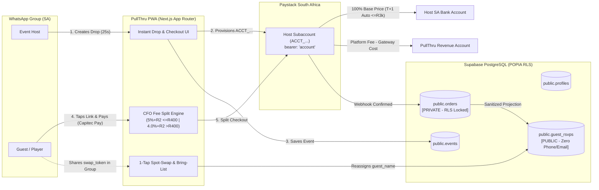

# PullThru (`pullthru.co.za`) — Master Architecture & Regulatory Blueprint
**South Africa's Universal WhatsApp Event RSVP & Chip-In Kitty PWA**  
**Prepared by:** CTO & Database Architect  
**Status:** Production Baseline (Audited Legal, Tax, Financial & Engineering Specification)

---

## 1. Executive Summary

In South Africa, every social gathering—from Tuesday night 5-a-side turf soccer and Padel bookings to weekend braais, kids' birthday parties, hiking clubs, baby showers, and *umgalelo* condolence collections—starts in a WhatsApp group and descends into administrative chaos:
1. **The Copy-Paste List Nightmare:** Endless scroll chains of numbered lists where people accidentally overwrite each other, drop out at the last minute, or add "+1s" without accountability.
2. **The Host's Out-of-Pocket Burden:** The organizer fronts R1,200 for the Fives Futbol court or R2,500 at Checkers Sixty60 for meat and wood, then spends two weeks chasing fake EFT screenshots, "I'll pay you on Friday" promises, and awkward bank account reminders.
3. **High-Friction Ticketing Platforms:** Traditional ticketing systems (Quicket, Howler, Webtickets) are built for commercial concerts and festivals. They require heavy logins, force mandatory email registrations, hold funds until days after the event, and feel alien for casual social coordination.

**PullThru (`pullthru.co.za`)** is South Africa's instant, zero-app-download Progressive Web App (PWA) engineered natively for WhatsApp. A host creates a PullThru drop in under 25 seconds, pastes the link into the WhatsApp group, and guests lock in their spot (or chip into the kitty) in two taps via **Capitec Pay**, **Instant EFT**, **Apple Pay**, or **Card**—while claiming bring-along items (ice, blitz, salads), locking in `+1` bundles, or logging a verified **25th Payday Promise**.

### The 4 Universal Event Modes

PullThru's database and checkout engine unify every South African social format under four strict polymorphic modes (`EventMode`):

| Mode (`mode`) | Primary Use Cases | Pricing & Inventory Mechanics | Wall & Privacy Defaults |
| :--- | :--- | :--- | :--- |
| **`fixed`** *(Fixed Ticket / Pitch Split)* | 5-a-Side Soccer, Padel Court Split, Paid Run Club, Wine Tasting | Fixed per-spot ZAR price (`price_zar >= R50`). Optional strict capacity cap (`max_spots`). Supports multi-spot `+1` bundle math where the R2.00 fixed fee is charged once per checkout. | Public social roster with live spot countdown (`e.g., 8/10 spots locked`). |
| **`tiered`** *(Multi-Tiered Braai / Gathering)* | Braai & Potjie, Weekend Away, Family Reunion, Supper Club | Host defines `tiers` (`JSONB` array of `EventTier`). Allows mixed paid & free tiers in one link (e.g., *R150 Meat & Dop*, *R80 Halaal / Veg*, *R0 Sober Driver / Under-12 Kids*). | Displays tier badge alongside guest name; R0 tiers bypass Paystack and lock spots immediately. |
| **`pot`** *(Open Chip-In Kitty / Umgalelo)* | Teacher's Gift, Baby Shower, Farewell Envelope, One-Off Bereavement *Umgalelo* | Open variable contribution (`min_pot_contribution_zar >= R50`), optional suggested amount (`price_zar`) and target goal bar (`target_pot_zar`). | Supports `hide_amounts_on_wall = true` so guests see *who* chipped in and their heartfelt comment, without exposing individual ZAR amounts. |
| **`free`** *(Zero-Rand RSVP & Bring-List)* | Kids' Birthday Party, Sunday Hike, Run Club, Bring-and-Braai | `price_zar = 0`. Zero payment gateway friction. Guests lock headcount (`+1s`), answer `custom_question` (e.g., dietary requirements), and claim items from `bring_items` (e.g., *"🧊 4x Bags of Ice"*). | 100% free utility engine driving viral host acquisition across WhatsApp groups. |

---

## 2. Audited Legal, Tax & Regulatory Architecture

PullThru is architected from the database layer up to operate in strict compliance with South African financial, tax, consumer protection, and privacy statutes—without requiring a banking license, money-remitter registration, or third-party trust account audit.

### 2.1 SARB Directive 1 of 2007 (Zero Custody of Third-Party Funds)
Under the **South African Reserve Bank (SARB) National Payment System Act (Act 78 of 1998)** and **Directive 1 of 2007**, aggregating funds due to third-party beneficiaries into a platform's own corporate bank account and subsequently paying them out constitutes illegal clearing/settlement and deposit-taking unless licensed as a System Operator or TPSP through a sponsoring bank.

**Architectural Enforcement:**
- **100% Split-at-Source via Paystack SA Subaccounts:** Every host who collects paid contributions on PullThru is provisioned a native **Paystack Subaccount** (`subaccount_code = ACCT_...`) linked directly to their personal or business South African bank account across all **12 supported SA banks**:
  1. **Capitec Bank** (`470010`)
  2. **First National Bank (FNB)** (`250655`)
  3. **Standard Bank** (`051001`)
  4. **Nedbank** (`198765`)
  5. **Absa Bank** (`632005`)
  6. **TymeBank** (`678910`)
  7. **Discovery Bank** (`679000`)
  8. **Bank Zero** (`888000`)
  9. **Investec Bank** (`580105`)
  10. **African Bank** (`430000`)
  11. **Sasfin Bank** (`683000`)
  12. **Bidvest Bank** (`462005`)
- **Direct Gateway Routing (`bearer: "account"`):** Every checkout payload sent to `POST https://api.paystack.co/transaction/initialize` specifies:
  - `subaccount`: The Host's `ACCT_...` code.
  - `transaction_charge`: PullThru's exact `platform_fee_cents`.
  - `bearer: "account"`: Explicitly instructs Paystack that the main platform account (`pullthru.co.za`) bears 100% of Paystack's gateway processing fee out of `transaction_charge`.
- **Zero Intermingling:** The Host's `base_price_cents` is settled **100% intact** by Paystack's acquiring bank directly to the Host's bank account. PullThru never holds, touches, or sweeps host funds.

### 2.2 SARS VAT Act Section 54 (Disclosed Agent) & Section 12E SBC Tax
If a platform records gross ticket/pot inflows as its own turnover, it will artificially breach the **R1,000,000 compulsory VAT registration threshold** once total host event volume hits ~R1M, forcing a 15% VAT tax hike on casual braai and soccer contributions.

**Architectural Enforcement:**
- **Section 54 Disclosed Principal-Agent Relationship:** PullThru acts strictly as a **Disclosed Agent** for the named Event Host (`host_name` / `host_handle`), collecting the base event contribution (`base_price_cents`) on the Host's behalf while charging the Guest a separate, explicit **Instant Software RSVP & Clearing Fee** (`platform_fee_cents`).
- **Bifurcated Checkout & Tax Receipt:** Every checkout modal and electronic receipt strictly bifurcates the transaction into two distinct line items:
  1. **Line Item 1 — Base Contribution (Collected as Disclosed Agent for Host `@handle`):** `R[Base Price]` → Settled 100% to Host via Paystack Subaccount. Excluded from PullThru's gross income and VAT turnover.
  2. **Line Item 2 — PullThru Instant Software RSVP & Clearing Fee:** `R[Platform Fee]` → Recognized as PullThru's sole gross revenue (`turnover`).
- **Income Tax Act Section 12E (Small Business Corporation - SBC):** Because only Line Item 2 (`platform_fee_cents`) enters PullThru's revenue ledger, PullThru can process over **R20,000,000+ in gross community event volume** before its own platform fee turnover reaches the R1,000,000 compulsory VAT registration threshold, while qualifying for SARS **Section 12E Small Business Corporation** graduated corporate tax rates (0% on the first R95,750 of taxable income; 7% up to R365,000; 21% up to R550,000).

### 2.3 Gateway CFO Fee Math & Multi-Spot (`+1`) Bundle Optimization
Paystack South Africa charges `2.0%` (ex VAT, or `2.30%` incl. 15% VAT) for Capitec Pay / Instant EFT and `2.9% + R1.00` (ex VAT, or `3.335% + R1.15` incl. 15% VAT) for local Visa/Mastercard transactions. Because `bearer: "account"` deducts Paystack's fee from PullThru's `transaction_charge` calculated on the **entire gross charge** (`base + fee`), uncalibrated flat fees on micro-tickets or high-value pots would either erode net margins or feel punitive to guests.

**The Audited PullThru Fee Formula (`src/lib/fees.ts`):**
1. **R50.00 Minimum Paid Threshold:** Paid tiers and open pot contributions require a minimum base of **R50.00** (anything below R50 uses `free` mode or combines spots).
2. **Tier 1 — Standard Social Tier (`Total Base <= R400.00`):**
   $$\text{Platform Fee} = \text{round}(\text{Total Base} \times 5\%) + \text{R2.00}$$
   - *Example (R100 5-a-Side Pitch Split):* Base = `R100.00` | Fee = `R7.00` (`5% + R2`) | Guest Pays = `R107.00` | Host Gets = `R100.00`.
     - After Paystack Card Fee (`R4.72` incl. VAT), PullThru nets **`+R2.28`** per checkout.
     - After Paystack Capitec Pay Fee (`R2.46` incl. VAT at 2.30%), PullThru nets **`+R4.54`** per checkout.
3. **Tier 2 — High-Value Reduced Trip Rate (`Total Base > R400.00` up to R5,000.00 FICA Cap):**
   $$\text{Platform Fee} = \text{round}(\text{Total Base} \times 4.0\%) + \text{R2.00}$$
   - *Example (R500 Weekend Pot / Gift):* Base = `R500.00` | Fee = `R22.00` (`4.0% + R2`) | Guest Pays = `R522.00` | Host Gets = `R500.00`.
   - *Uncapped up to the R5,000.00 FICA Velocity Cap:* Because Paystack local card processing costs `3.335% + R1.15` (incl. 15% VAT) on the gross transaction amount (`base + fee`), maintaining a linear `4.0% + R2.00` rate up to the R5,000 single-checkout velocity cap guarantees that PullThru never suffers negative net margin on large card checkouts (e.g., at R5,000 base, Fee = `R202.00`, Paystack Card Fee = `R174.64`, Net Card Margin = **`+R27.36`**; Net Capitec Pay Margin = **`+R82.35`**).
4. **Multi-Spot (`+1`) Bundle Optimization:** When a guest books $N$ spots in a single checkout (e.g., booking for themselves + 2 friends = 3 spots at R100 each), the percentage is applied to the combined base (`R300 × 5% = R15.00`), and the **R2.00 fixed clearing fee is charged only ONCE (`R17.00` total instead of `R21.00`)**. This incentivizes guests to pay for their friends in one checkout and saves PullThru multiple R1.15 fixed gateway hits.

### 2.4 The 2-Tier Host Trust Ladder (`auto` T+1 vs `manual` Settlement)
A core insight of South African social events is that **casual hosts need the cash *before* the event**—the braai host buys meat at Checkers on Saturday morning for Saturday afternoon's braai; the 5-a-side captain pays Fives Futbol at the desk before kick-off. However, high-value public ticket pools carry friendly-fraud and chargeback risk.

PullThru solves this via a **2-Tier Host Trust Ladder** enforced on the Paystack Subaccount `settlement_schedule`:
- **Tier 0 (`tier_0_new` — Default Instant Onboarding):**
  - **Pools $\le$ R3,000 (`settlement_schedule: "auto"`):** Paystack settles **T+1 business day** directly to the Host's bank account so they can buy the meat, ice, or pay the turf pitch *before* the event starts.
  - **Pools $>$ R3,000 (`settlement_schedule: "manual"`):** If an unverified host's event pool exceeds R3,000, settlement automatically switches to `manual` (held safely inside Paystack's acquiring bank until T+1 *after* the event date or host verification) to eliminate hit-and-run fraud risk.
- **Tier 1 (`tier_1_trusted` — Verified Repeat Host):**
  - Unlocked after 3 successful events with zero disputes or instant FICA/ID check. Enjoys `auto` T+1 settlement up to R15,000+ per event.

### 2.5 National Gambling Act (Act 7 of 2004) & Insurance Act (Act 18 of 2017) Blocklist
To protect PullThru's Paystack master account and directors from criminal liability:
1. **National Gambling Act Section 7 & Lotteries Act:** PullThru strictly prohibits any event involving a prize of money or money's worth determined wholly or partly by chance or sports outcomes.
   - **Explicitly Blocked:** Fantasy Premier League (FPL) cash buy-in leagues, SuperBru cash pools, Last-Man-Standing betting pots, 50/50 raffles, lucky draws, and casino nights.
2. **Insurance Act (Act 18 of 2017) — Informal Burial Societies vs. One-Off *Umgalelo*:**
   - **Explicitly Blocked:** Recurring monthly funeral/burial society premiums that promise a contingent future payout upon death (which constitutes unlicensed micro-insurance underwriting).
   - **Explicitly Permitted:** **One-off, non-contractual bereavement condolence pots (*Umgalelo* / *Imali yenduduzo*)** created *after* a specific bereavement to help a colleague, teammate, or neighbour with immediate grocery, catering, or family support costs, where there is zero ongoing premium or guaranteed insurance benefit.
3. **Automated Keyword Guardrail:** Both the client event builder and database check constraints scan titles and descriptions against prohibited gambling/lottery/underwriting triggers before creation.

### 2.6 POPIA (Act 4 of 2013), CPA (Section 49) & ECTA (Section 43) Compliance
1. **POPIA Data Minimization & Synthetic WhatsApp Email Proxy:**
   - South African WhatsApp users hate typing email addresses on mobile, yet Paystack's API requires a valid `email` string.
   - If a guest leaves email blank, PullThru synthesizes a deterministic, non-routable proxy address: `wa_27821234567@rsvp.pullthru.co.za` (`is_synthetic_email = true`) and delivers their confirmation receipt and **1-Tap WhatsApp Spot-Swap Link** natively via WhatsApp.
2. **Strict Separation of Financial Orders (`public.orders`) and Public Social Wall (`public.guest_rsvps`):**
   - `public.orders` contains PII (`buyer_whatsapp`, `buyer_email`, `paystack_reference`, `base_price_cents`). Row-Level Security (RLS) **completely blocks anonymous/public `SELECT` access** on `public.orders`.
   - `public.guest_rsvps` powers the public social wall. It contains **zero phone numbers and zero email addresses**—only `guest_name`, `plus_one_names`, `badge_label`, `claimed_item_label`, and `status`.
   - **Positive-Only Public Wall:** PullThru never renders a public "Declined / Can't Make It" list (preventing social awkwardness and unnecessary processing of non-attendee data).
   - **Anonymous Gift Mode:** Guests can toggle `is_anonymous_on_wall = true` (displaying as *"🔒 Anonymous Legend"* on the public wall while remaining visible to the Host on their private check-in sheet), and Hosts can enable `hide_amounts_on_wall = true` for sensitive gift/bereavement pots.
3. **CPA Section 49 Clickwrap & Self-Service Spot-Swap Engine:**
   - Under Section 49 of the Consumer Protection Act, any limitation of liability or non-refundable fee notice must be drawn to the consumer's attention in **plain language and conspicuous formatting prior to conclusion of the transaction**.
   - Every paid checkout requires an explicit `cpa_s49_accepted = true` checkbox acknowledging that:
     - The **Instant Software RSVP & Clearing Fee** (`platform_fee_cents`) is for instant software execution and payment clearing and is non-refundable.
     - The **Base Contribution** (`base_price_cents`) is settled directly to the disclosed Event Host (`@handle`), who governs event cancellations/refunds.
     - **Zero-Admin Spot-Swap:** Instead of demanding refunds from the Host when a player pulls a hamstring 3 hours before kick-off, every paid RSVP generates a unique cryptographic `swap_token`. The guest shares their **Spot-Swap Link** in the WhatsApp group, and the replacement player claims the spot in one tap—updating the host's roster instantly with zero gateway reversals.
4. **ECTA Section 43 Mandatory Disclosures:**
   - PullThru's footer and checkout modal disclose full statutory operator particulars, physical address for legal service, support contact, agency relationship, and security architecture as required by Section 43 of the Electronic Communications and Transactions Act (Act 25 of 2002).

---

## 3. System & Data Architecture

---

## 4. The R1,000 Launch Budget & Week 1 Ground-Game Playbook

PullThru does not need paid Meta/Google ads to reach profitability. Every event created on PullThru is forcibly shared into a WhatsApp group of **12 to 50 high-intent local peers**, where every guest sees the live roster, claims a bring-item, and experiences the 5-second Capitec Pay lock-in.

### 4.1 Allocation of the R1,000 Bootstrap Budget

| Budget Line Item | Allocation (ZAR) | Exact Deployment |
| :--- | :--- | :--- |
| **1. `pullthru.co.za` Domain Registration** | **R99.00** | Register `pullthru.co.za` via Xneelo / Absolute Hosting / Porkbun (12 months). |
| **2. Vercel & Supabase Hosting** | **R0.00** | Free Commercial Starter Tiers (handles up to 50,000 MAUs and 500MB PostgreSQL rows with zero fixed monthly burn). |
| **3. Weatherproof QR Table-Talkers & Pitch Stickers** | **R350.00** | 30x laminated A5 QR cards + 50x vinyl stickers for Fives Futbol & Padel club check-in desks: *"Stop chasing EFTs for tonight's court. Split the pitch in 25 seconds."* |
| **4. "First-Pot Ice & Chasers" Host Bounty** | **R450.00** | 9x **R50 Checkers Sixty60 Ice & Blitz Vouchers** awarded instantly to the first 9 hosts who lock 10+ paid spots on a weekend Braai or 5-a-side game. |
| **5. Emergency WhatsApp Data / Contingency** | **R101.00** | Founder ground-game connectivity reserve. |
| **TOTAL LAUNCH CAPITAL** | **R1,000.00** | **Break-Even Volume: Just 143 standard R100 spots (~14 games of 5-a-side).** |

### 4.2 Week 1 Ground-Game Playbook (Fives Futbol, Padel & Braai Captains)

- **Days 1–2 (Tuesday/Wednesday Night 5-a-Side Blitz):**
  - Walk onto 3 local **Fives Futbol / Urban 5s** venues between 17:45 and 20:30.
  - Spot the team captain standing at the kiosk asking *"Who hasn't EFT'd me yet?"* while swiping their personal card for R1,100.
  - Onboard the captain on the spot in 25 seconds using their mobile number and bank account. Set up next week's recurring game link (`fixed` mode, `max_spots: 10`, `price_zar: 110`) with **Payday Promise** and **1-Tap Spot-Swap** enabled.
- **Days 3–4 (Padel WhatsApp Community Seeding):**
  - Target the admin of 5 local **Playtomic / Africa Padel WhatsApp matchmaking groups** (where players constantly drop out 2 hours before a court booking).
  - Position PullThru's **Spot-Swap Link** as the cure for late Padel dropouts: *"Whoever takes my 18:00 court slot taps this link to swap their name onto the court list."*
- **Days 5–7 (Weekend Braai, Run Club & *Umgalelo* Loop):**
  - Seed 5 weekend Braai hosts with the **R50 Checkers Ice Bounty** when they use `tiered` mode (*Meat & Dop* vs *Veggie* vs *Kids Free*) + the **Interactive Bring-List** (`🧊 4x Bags of Ice`, `🥗 Potato Salad`, `🔥 2x Rooikrans Wood`).
  - Every guest who claims *"🧊 4x Bags of Ice"* on Saturday sees the *"Host your own Braai, Soccer or Kitty in 25s"* banner at the bottom of the live WhatsApp wall—turning guests into Monday morning hosts for office farewell gifts and next week's games.
